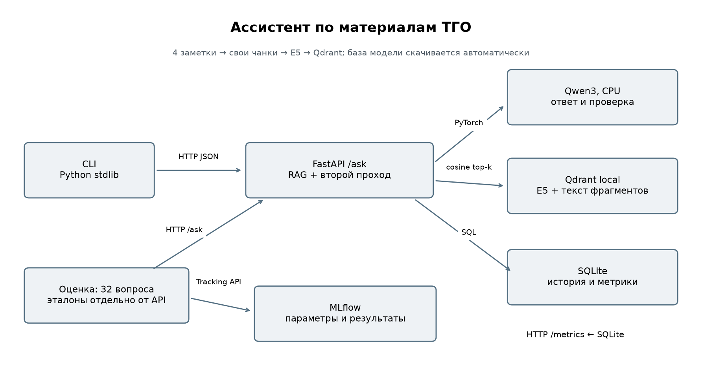
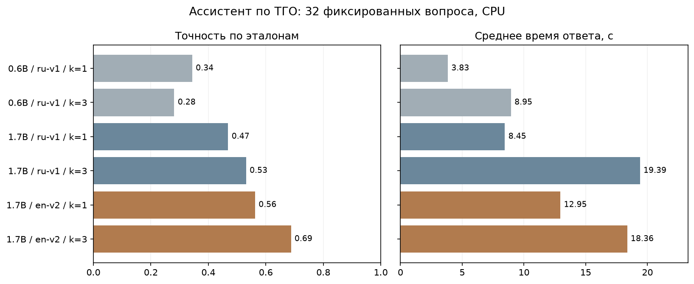

# Ассистент по материалам ТГО

Луценко Вячеслав Александрович, М092501(77). Тема 1: ассистент по корпусу документов с проверкой ответов.

Сервис отвечает на вопросы по четырем заметкам курса: функции потерь, внимание, обучение и подготовка ассистентов. Он находит фрагменты, составляет ответ и отдельным проходом проверяет опору на источники. Вопросы о расписании, личных данных и других отсутствующих фактах должны приводить к отказу.

## Устройство



[Исходник Mermaid](architecture.mmd). Четыре компонента:

- CLI использует только HTTP JSON, не импортирует модель и не читает базу.
- FastAPI загружает Qwen3-1.7B и E5-small на CPU. Разбиение, сборка промпта и проверка написаны самостоятельно; LangChain и аналогов нет.
- Qdrant local хранит векторы и тексты 87 фрагментов, SQLite — запросы, ответы, время, токены и отказы. Отдельный модуль хранилища не зависит от модели.
- MLflow хранит параметры и метрики опытов; `/metrics` показывает число запросов, среднее и p95 времени, долю отказов, число сгенерированных токенов и ошибки.

SQLite и локальный Qdrant выбраны для небольшого корпуса и одного процесса: отдельные серверы БД здесь не нужны. Модели вызываются через Transformers, потому что те же Qwen и E5 уже проверены в лабораторных. Это замена рекомендованному серверу Ollama, HTTP-граница остается между CLI и инференсом.

## Запуск Docker

Из корня репозитория:

```powershell
docker compose -p tgo-course -f coursework/docker-compose.yml up --build --wait -d
```

API: `http://127.0.0.1:8000`, документация: `/docs`, MLflow: `http://127.0.0.1:5000`. Первый запуск скачивает базовые веса автоматически; нужен интернет, свободное место и время. Флаг `--wait` ждет готовности сервиса. Повторные запуски используют том с кешем. Веса в Git не лежат. Контейнер API ограничен 16 ГиБ, GPU ему не передается.

CLI на компьютере использует только стандартную библиотеку:

```powershell
python coursework/cli.py "Что означает weight decay в AdamW?"
python coursework/cli.py --metrics
```

CLI в контейнере:

```powershell
docker compose -p tgo-course -f coursework/docker-compose.yml --profile cli run --rm --build cli "Что означает weight decay в AdamW?"
```

Переменные перечислены в [.env.example](.env.example). Для изменения портов можно скопировать его в `coursework/.env` и передать `--env-file coursework/.env`. Секретов для открытых моделей нет. `COURSE_MODEL` выбирает 0.6B или 1.7B, `COURSE_PROMPT` — `ru-v1` или `en-v2`.

Без Docker: поставить `coursework/requirements.txt` в окружение с CPU PyTorch и выполнить `python -m uvicorn coursework.api:app --host 127.0.0.1 --port 8000`. Команды выполняются из корня; не запускать два процесса с одним каталогом локального Qdrant.

## Проверка развернутого сервиса

На этом компьютере Docker видит 15.37 ГиБ памяти, лимит контейнера API — 16 ГиБ. GPU не используется. Пик памяти cgroup за проверку — 8.35 ГиБ. [Проверка HTTP](eval/results/deployment.json) на трех последовательных запросах:

| Вопрос | Время HTTP, с | Отказ |
|---|---:|---|
| Что означает weight decay в AdamW? | 33.11 | нет |
| Из какого распределения шума получается средняя квадратичная ошибка? | 33.99 | нет |
| В каком кафе преподаватель будет обедать завтра? | 9.72 | да |

Все три запроса уложились в 120 секунд, счетчик SQLite вырос на три. После перезапуска контейнера история сохранилась; [ресурсы и проверка сохранности](eval/results/deployment-resources.json). Время холодной загрузки моделей сюда не включено.

Настоящие выводы: [CLI на компьютере](eval/results/cli-host.txt), [CLI в контейнере](eval/results/cli-container.txt). Пример curl из PowerShell:

```powershell
curl.exe -H "Content-Type: application/json" --data-binary "@coursework/eval/request-example.json" --output coursework/eval/results/curl-response.json http://127.0.0.1:8000/ask
```

Полный [JSON ответа](eval/results/curl-response.json) содержит время, токены и найденные фрагменты. Текст ответа:

```text
Weight decay в AdamW означает, что параметры модели немного притягиваются к нулю на каждом шаге обучения, что помогает предотвратить переобучение. Это регуляризация, которая снижает риск чрезмерного улучшения модели.

[3]
```

Скриншот работы интерфейса пока не добавлен; примеры выше сохранены из реального запуска.

## Оценка и эксперименты

[Набор](eval/dataset.json) зафиксирован до первого прогона: 24 вопроса с ответом в заметках и 8 без ответа. У известных ответов сохранены исходный раздел и его текст. Сервер получает только вопрос, top-k и флаг проверки, эталоны не передаются в запросе. Тестовый набор исключен из Docker-образа API.

```powershell
python -m pip install -r coursework/requirements.txt
python -m coursework.eval.run --output coursework/eval/results/repeated --tracking-uri http://127.0.0.1:5000
python -m unittest coursework.test_service -v
```

Один запуск оценки сравнивает top-k=1 и top-k=3. Остальные параметры сервера одинаковы. Все запросы действительно проходят HTTP API; ответы, секунды и токены записываются в результаты и SQLite. Опыты записываются в MLflow. [Выполненные ноутбуки](notebooks/) сохраняют выводы ячеек.

| Модель | Инструкция | top-k | Точность | Recall раздела | Верный отказ | Галлюцинации* | Среднее, с | Максимум, с |
|---|---|---:|---:|---:|---:|---:|---:|---:|
| 0.6B | ru-v1, прототип | 1 | 0.344 | 0.708 | 1.000 | — | 3.83 | 7.93 |
| 0.6B | ru-v1, прототип | 3 | 0.281 | 0.875 | 1.000 | — | 8.95 | 16.86 |
| 1.7B | ru-v1 | 1 | 0.469 | 0.708 | 1.000 | — | 8.45 | 19.00 |
| 1.7B | ru-v1 | 3 | 0.531 | 0.875 | 1.000 | — | 19.39 | 43.59 |
| 1.7B | en-v2 | 1 | 0.562 | 0.708 | 1.000 | 27.8% | 12.95 | 39.95 |
| 1.7B | en-v2 | 3 | 0.688 | 0.875 | 1.000 | 20.0% | 18.36 | 57.06 |

Выбрал Qwen3-1.7B, en-v2, top-k=3: 22 верных результата из 32, в том числе 14 из 24 вопросов с ответом в корпусе и 8 верных отказов из 8. Нужный раздел найден в 21 из 24 случаев. Для основного сравнения использую две итоговые строки en-v2 с одинаковым хешем кода; ранние прогоны оставлены как журнал разработки.



*Галлюцинации: доля принятых ответов, содержащих хотя бы одно неподтвержденное или противоречащее источнику фактическое утверждение. В [явной сверке](eval/results/final/source-review-annotations.json) это 5 из 18 для k=1 и 4 из 20 для k=3. Неполный ответ и верная цитата не по вопросу отдельно не названы галлюцинациями. Сверка подготовлена с ИИ-ассистентом по исходным текстам; независимой экспертной разметки нет. Спорные случаи и причины сохранены, цитаты и хеши ответов проверяет `python -m coursework.eval.source_review`. Метрики сверки также записаны в MLflow. Для ранних конфигураций такая сверка не выполнялась (— в таблице).

Пример явного сбоя: в q19 модель утверждает, что токены промпта не влияют на ответ, хотя источник прямо говорит об их влиянии через внимание. Проверяющий проход одобрил это утверждение. В q17 число 11 повторных предъявлений корпуса перенесено в ответ об оптимуме Chinchilla, где источник называет около 20 токенов на параметр.

Точность проверяется по заранее записанным ключевым понятиям, отказ на известный вопрос считается ошибкой. Recall означает найденный правильный **раздел**, а не гарантию, что внутри выбранного обрезанного фрагмента есть весь ответ. Дополнительно сохранены token-F1 и доля ошибок среди принятых ответов. Ключевые слова могут не зачесть эквивалентную формулу или английский термин; это ограничение автоматической оценки, а не повод менять эталоны после прогона.

Сравнение инструкций включает изменение проверки формата, поэтому разницу нельзя приписать только языку промпта. Внутри каждой пары top-k код проверки одинаков. 32 вопроса использовались для выбора конфигурации; качество на независимом новом наборе отдельно не измерено.

Переносимые экспорты MLflow находятся в `eval/results/**/mlflow-export.json`. Для просмотра уже выполненных опытов в чистом Docker MLflow:

```powershell
python -m coursework.eval.import_runs
```

Импорт помечен тегом `source_run_id`, прикладывает оригинальный экспорт и не выполняет новый инференс. Исходные времена сохранены в тегах `source_start_time` и `source_end_time`; время новой записи соответствует самому импорту. Повторный импорт не дублирует опыты.

## Ограничения

Маленькая модель часто отказывается даже при найденном источнике, а второй проход той же модели иногда одобряет неполный или неверный ответ. Его ДА/YES не является независимым доказательством. Ссылки вне выданных номеров отклоняются кодом; en-v2 также отклоняет ответ, состоящий из одной ссылки. Проверка по смыслу остается слабым местом.

Доля ошибок принятых ответов не равна доле галлюцинаций: среди них есть неполные ответы и ошибки проверки ключевых слов. Числовые ссылки проверяются на допустимый диапазон, но модель иногда оставляет шаблон `[n]`; это известный дефект оформления. Для просмотра самих фрагментов и причин отказа у CLI есть `--json`. Время зависит от процессора и фоновой нагрузки; первые загрузки моделей в latency ответа не входят.

Это локальный учебный сервис без авторизации и очереди задач. Порты Docker привязаны к 127.0.0.1. Генерация сериализована: при нескольких одновременных запросах время ожидания возрастет. Чанки задаются символами с перекрытием и затем ограничиваются 512 токенами E5; часть длинных формул может обрезаться.

## Файлы

`api.py` — HTTP, `engine.py` — ответ и проверка, `retrieval.py` — чанки и индекс, `storage.py` — журнал и метрики, `cli.py` — интерфейс, `eval/` — вопросы, оценка и экспорты, `notebooks/` — настоящие прогоны, `Dockerfile*` и `docker-compose.yml` — запуск компонентов. Корпус — исходные `lectures/*/*.md` из [курса П. Меньших](https://github.com/pmenshih/tgo-course).
